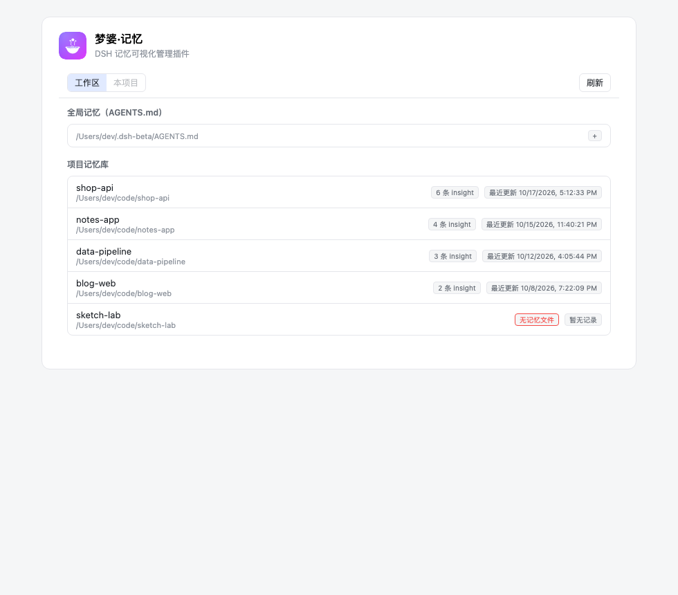
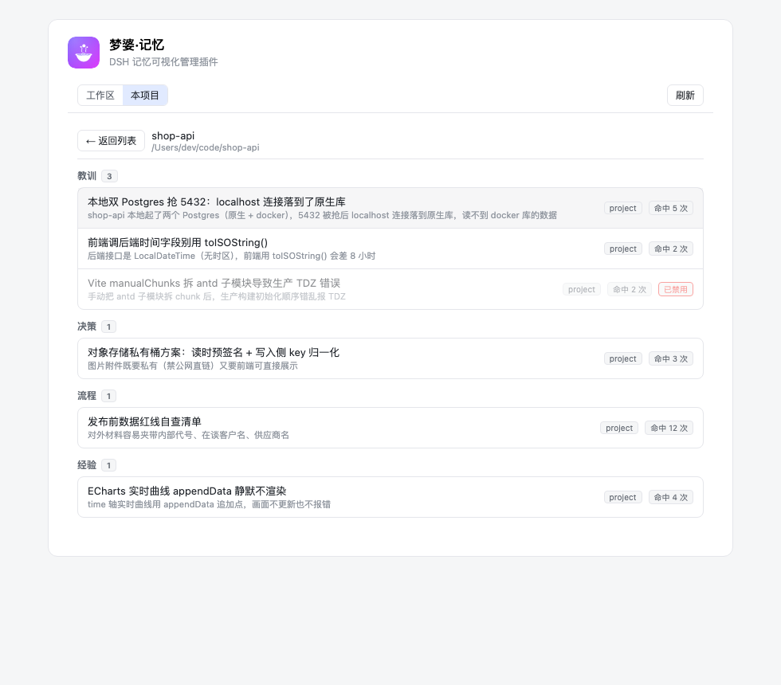
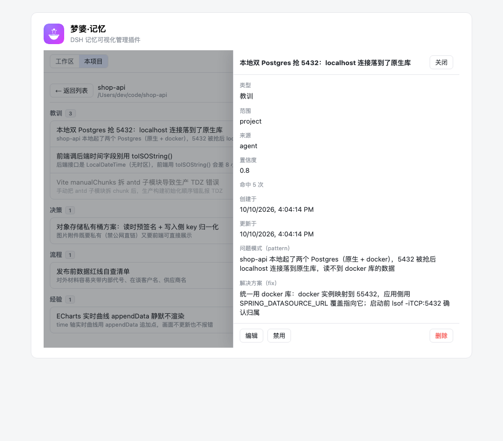
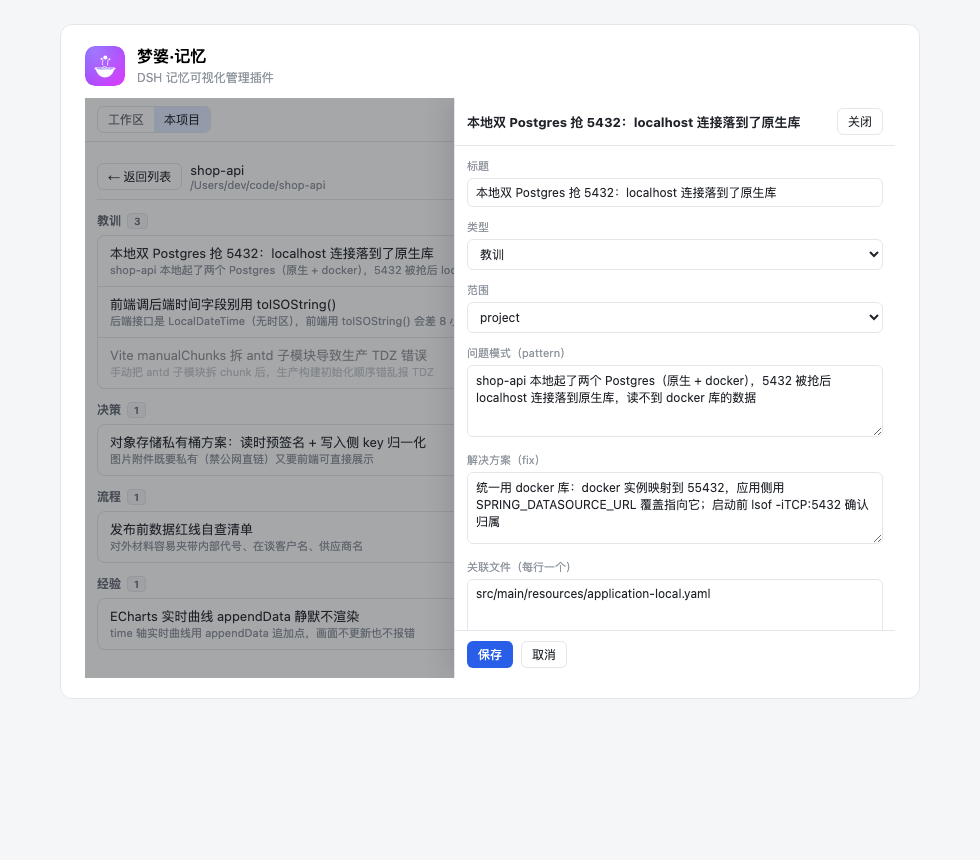

<div align="center">


# 梦婆·记忆 · dsh-mengpo

**DSH（DeepSeek Harness）本地记忆的可视化管理插件** —— 在「插件」页里查看、编辑、删除、禁用你的全局记忆与每一个项目的记忆。

[](LICENSE)
[](https://www.npmjs.com/package/dsh-mengpo)
[](https://github.com/topics/dsh-plugin)

> 名字取自「**孟婆汤**」谐音：传说喝下便忘，而这个插件反其道而行 —— 把那碗汤端到你面前，让你看清自己攒下了什么、哪些该倒掉。图标就是那只碗：碗内是汤，升起的是记忆。

</div>

---

## 它解决什么问题

DSH 的记忆默认只有「写入」没有「界面」：全局偏好写在 `~/.dsh-beta/AGENTS.md`，每个项目的经验/决策沉淀在 `<项目>/.dsh-project-memory/insights.json`。agent 一直在往里记（`save_lesson` / `remember` / 自动注入），但你**看不到自己攒了什么，也删不掉过时的条目**。梦婆把这个黑盒变成可浏览、可编辑的界面。

## 功能与界面

### 工作区视图：全局记忆 + 项目记忆库总览

一眼看到全局记忆（AGENTS.md）和所有项目记忆库：insight 数、最近更新时间；有目录无数据的标「无记忆文件」，坏 JSON 标「数据损坏」而不拖垮整页。



### 项目视图：按类型分组的 insight 列表

点任意项目进入。insight 按 kind 分组（教训 / 决策 / 流程 / 经验），标注作用域、命中次数；被禁用的条目置灰留存，防止旧坑回潮。



### 详情抽屉：看全文，也能动手

点任意一条 insight，右侧抽屉展示完整元信息（类型 / 范围 / 来源 / 置信度 / 命中次数 / 创建与更新时间）+ pattern / fix / 关联文件 / 触发条件全文。



### 编辑 / 禁用 / 删除

抽屉底部三个操作：**编辑**（标题、类型、范围、pattern、fix、文件、trigger，保存即原子写回）、**禁用/启用**（等价 `draft: true|false`）、**删除**（二次确认，永久移除）。



## 安装

```bash
# 从 NPM 安装（推荐；应用内「插件中心」一键装）
dsh plugin --profile <your-profile> add dsh-mengpo

# 或直接从本仓库源码安装
dsh plugin --profile <your-profile> add github:LogosFu/dsh-mengpo
```

> 桌面端的 profile 由 Electron 独占管理（CLI 会拒绝写入），请在界面里装：
> 侧边栏 **插件 → 添加插件 → 安装第三方插件**，填入 `dsh-mengpo`（或 GitHub 地址 / 本地目录）。

装完重启 DSH，进入 **插件** 页 → **内置插件配置** → 点「**梦婆·记忆**」卡片。

## 数据与权限

| 项 | 说明 |
|---|---|
| 读取 | `~/.dsh-beta/AGENTS.md`、`~/.dsh-beta/storages/session_projcache/sessions/*.json`（只取 `record.identity.cwd` 用于项目发现）、各项目 `.dsh-project-memory/insights.json` |
| 写入 | **仅**各项目自己的 `.dsh-project-memory/insights.json`（编辑/删除/禁用时） |
| 不写入 | `~/.dsh-beta` 下任何文件；不联网；不采集遥测 |
| 写回策略 | 重读-合并-原子写（tmp + rename，提交前复查 mtime，冲突自动重试最多 3 次），保留 id/createdAt/hitCount/source |

## 兼容性

- 已验证：DSH Desktop **2.0.18-beta.1**（macOS，`desktop` profile）
- 只用公开插件机制：`plugins.item` 设置卡 slot + 手写 Typert Remote 描述符（**不引入** `@deepseek-ai/*` 运行时依赖，零安装体积负担）
- Node ≥ 22（宿主 runtime 提供）

## 开发

```bash
pnpm install
pnpm build      # lib/index.js（host）、lib/client.js（web）、lib/types/
pnpm test       # vitest：项目发现、insights 读写、原子写回与 mtime 冲突重试
pnpm spike      # 模拟 ModuleLoader/cordis 加载构建产物（33 项断言）
pnpm smoke      # 对真实 ~/.dsh-beta 只读冒烟：项目列表 + insight 计数
pnpm typecheck
```

架构与已拍板决策见 [docs/design.md](docs/design.md)。

## 卸载

「插件」页里停用或卸载即可，无后台进程、无残留文件。你的记忆数据不受影响（插件只读写既有 JSON）。

## License

[MIT](LICENSE)
